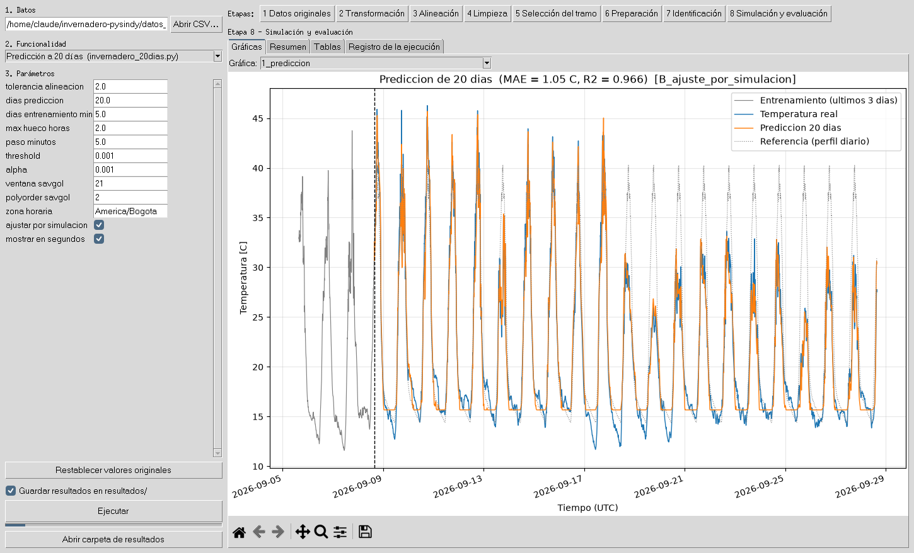

# Invernadero – identificación del modelo de temperatura con PySINDy

Proyecto modular que reorganiza los tres programas originales del curso
(`invernadero_profesor.py`, `invernadero_20dias.py` y `validar_modelo.py`), que
están intactos en `originales/`. Identifica una ecuación

```
dT/dt = a0 + aT·T + aL·L + aH·H        (T temperatura, L luminosidad, H humedad)
```

a partir de las mediciones del invernadero aeropónico. Además permite ver qué le
pasa a los datos en cada etapa, desde que se lee el CSV hasta que se evalúa el
modelo.



---

## 1. Instalación

### Requisitos

* **Python 3.12 o superior** (probado con 3.13). Para comprobarlo: `python --version`.
* **tkinter**, solo para la interfaz gráfica. Viene incluido con el Python de
  python.org en Windows y macOS. En Linux: `sudo apt install python3-tk`
  (Debian/Ubuntu) o `sudo dnf install python3-tkinter` (Fedora).

### Pasos

```bash
# 1. Descargar el proyecto
git clone https://github.com/jorgeg1824/invernadero-pysindy.git
cd invernadero-pysindy
#    (o descargar el ZIP desde GitHub, descomprimirlo y abrir una terminal en esa carpeta)

# 2. Crear un entorno virtual
python -m venv .venv

# 3. Activarlo
.venv\Scripts\activate          # Windows (PowerShell o cmd)
source .venv/bin/activate       # macOS / Linux

# 4. Instalar las dependencias (versiones fijas)
pip install -r requirements.txt

# 5. Comprobar
python cli.py --help
```

> **¿Por qué las versiones fijas?** El programa original del profesor da una
> ecuación distinta con pandas 2 y con pandas 3 (error E1, ver
> `docs/informe_final.md`). Para reproducir exactamente los resultados
> documentados, use las versiones de `requirements.txt`.
> `requirements-lock.txt` fija también las dependencias indirectas:
> `pip install -r requirements-lock.txt`.

En Windows, si `python` no se reconoce, use `py` (por ejemplo `py -m venv .venv`).

---

## 2. Ejecución

### Interfaz gráfica

```bash
python cli.py gui
```

1. **Datos:** ya viene cargado el CSV de ejemplo; *Abrir CSV…* para usar otro.
2. **Funcionalidad:** una de las cuatro de la tabla de abajo.
3. **Parámetros:** el formulario muestra los valores originales; se pueden
   cambiar. *Restablecer valores originales* los recupera.
4. **Ejecutar.** Luego, con los botones **1 a 8**, se recorren las etapas. Cada
   etapa tiene las pestañas *Gráficas* (con zoom y guardar), *Resumen* (texto),
   *Tablas* y *Registro de la ejecución*.

### Terminal

```bash
python cli.py barrido        # = invernadero_profesor.py
python cli.py prediccion     # = invernadero_20dias.py
python cli.py ventanas       # = validar_modelo.py
python cli.py estrategias    # compara las estrategias A, B y C (nuevo)
```

| Comando | Estrategia de modelado | Qué hace | Tiempo aprox. |
|---|---|---|---|
| `barrido` | **C** barrido de threshold (sobre A) | Elige el tramo por puntaje, entrena con los primeros 5 días, prueba 7 thresholds y se queda con el de menor RMSE de simulación | 20 s |
| `prediccion` | **A** PySINDy + **B** ajuste por simulación | Rellena huecos ≤ 2 h, entrena con el tramo más largo menos sus últimos 20 días, predice esos 20 días y simula todo el archivo | 15 s |
| `ventanas` | A + B | Repite `prediccion` en 6 ventanas de 20 días | 20 s |
| `estrategias` | A, B y C | Aplica las tres a los mismos datos y compara su error en la misma validación | 15 s |

Opciones útiles (`python cli.py <comando> --help` las muestra todas):

```bash
python cli.py barrido --unidad-tiempo original    # reproduce el original con pandas 3
python cli.py barrido --seleccion separado        # threshold elegido sin usar la validación
python cli.py prediccion --sin-ajuste             # solo PySINDy (estrategia A)
python cli.py prediccion --dias-prediccion 10 --threshold 0.01
python cli.py estrategias --ventana-savgol 5
python cli.py prediccion --csv otro_archivo.csv --salida mis_resultados
python cli.py prediccion --sin-guardar            # solo muestra el resumen

# Todos los parámetros con un archivo JSON:
python cli.py config prediccion > mi_config.json  # editar mi_config.json
python cli.py prediccion --config mi_config.json
```

### Qué se guarda

Cada ejecución crea `resultados/<AAAAMMDD-HHMMSS>_<comando>/`:

```
configuracion.json      parámetros usados
entorno.json            versiones de Python y librerías
registro.log            cada operación con la cantidad de registros antes -> después
resumen.txt             el mismo resumen que imprime la terminal
resultado.json          ecuación, coeficientes y métricas
01_datos_originales/    primeras filas, tipos de columna, filas por métrica, series originales
02_transformacion/      fechas antes/después, zona horaria, registros descartados
03_alineacion/          datos alineados, desfases entre variables
04_limpieza/            huecos, tramos, puntos rellenados o descartados
05_seleccion_tramo/     candidatos, tramo elegido y motivo
06_preparacion_modelo/  partición, derivada, parámetros de normalización
07_identificacion/      ecuación, términos activos, coeficientes (y barrido)
08_simulacion_evaluacion/ temperatura medida vs simulada, errores, métricas
```

Cada carpeta de etapa tiene `resumen.txt`, `resumen.json`, tablas `.csv` y
gráficas `.png`. En `resultados/` hay una ejecución de ejemplo de cada comando.

**Zona horaria:** las fechas del CSV terminan en `Z`, es decir, están en UTC. Se
comprueba en cada ejecución (etapa 2) y todas las gráficas usan UTC. Solo las
métricas por mes y por hora del día usan hora de Bogotá (`zona_horaria` en la
configuración).

---

## 3. Pruebas

```bash
python -m pytest                  # las 60 pruebas (~1 min)
python -m pytest -m "not lenta"   # sin las que usan el CSV completo (~2 s)
python -m pytest -v               # con el nombre de cada prueba
```

| Archivo | Qué comprueba |
|---|---|
| `test_carga.py` | Lectura y validación básica del CSV (con tabulador y con comas, columnas o variables faltantes) |
| `test_transformaciones.py` | Conversión de fechas y zona horaria; construcción de series con una tabla escrita a mano |
| `test_alineacion.py` | Alineación temporal con una tabla de resultado conocido (desfases, tolerancia, duplicados) |
| `test_limpieza_segmentacion.py` | Huecos, relleno en malla, tramos, selección y particiones |
| `test_normalizacion_derivadas.py` | Normalización, derivadas de funciones conocidas, unidad de tiempo con cualquier resolución de pandas |
| `test_modelos.py` | Recupera una ecuación conocida a partir de datos sintéticos (estrategias A, B y C) |
| `test_simulacion.py` | `lsim` vs solución analítica; RK45 vs `lsim` |
| `test_metricas.py` | RMSE, MAE y R² con valores calculados a mano |
| `test_pipeline_cli.py` | CLI, configuración JSON y que se guarden las 8 etapas |
| `test_equivalencia_original.py` | La versión modular reproduce la referencia de los programas originales |

El último resultado está en `docs/resultados_pruebas.txt`.

### Comparar con los programas originales

```bash
python comparacion/comparar_con_original.py
```

Ejecuta la versión modular y compara 164 aspectos (conteos, tramo, parámetros,
coeficientes, trayectorias y métricas) con `referencia_original/`. Escribe
`docs/comparacion_original_vs_modular.md`. Para regenerar la referencia
ejecutando los originales: `python referencia_original/ejecutar_referencia.py`
(en Linux sin pantalla: `xvfb-run -a python ...`).

---

## 4. Estructura

```
invernadero-pysindy/
├── cli.py                 punto de entrada (terminal e interfaz)
├── pipeline.py            registra y expone las funcionalidades
├── config.py              parámetros, rutas y opciones (valores de los originales)
├── flujos/                coordinación de cada funcionalidad, etapa por etapa
│   ├── comun.py           etapas 1-3 (iguales en todos) y registro de la ejecución
│   ├── barrido.py  prediccion.py  ventanas.py  estrategias.py
├── datos/                 leer, transformar, alinear, limpiar y segmentar
│   ├── carga.py  transformacion.py  alineacion.py  limpieza.py  segmentacion.py
├── analisis/              elegir tramo, dividir, derivar, normalizar
│   ├── seleccion_tramo.py  particion.py  derivadas.py  normalizacion.py
├── modelos/               ecuaciones y estrategias de modelado
│   ├── sindy.py           modelo PySINDy y su ajuste
│   ├── coeficientes.py    paso a unidades físicas y texto de la ecuación
│   ├── seleccion.py       criterios de comparación (RMSE, estabilidad)
│   └── estrategias/
│       ├── base.py                  interfaz común y ResultadoModelo
│       ├── identificacion_base.py   A: PySINDy
│       ├── ajuste_simulacion.py     B: ajuste de coeficientes por simulación
│       └── barrido_threshold.py     C: selección por barrido de threshold
├── simulacion/            integrar la ecuación (RK45, lsim) y predecir
├── evaluacion/            métricas, informes y registro en resultados/
├── visualizacion/         gráficas de datos, de la preparación y de los modelos
├── interfaz/aplicacion.py interfaz gráfica (solo presentación)
├── tests/                 pruebas pytest
├── originales/            los tres programas originales, sin modificar
├── datos_ejemplo/         CSV de ejemplo
├── referencia_original/   resultados de los originales (Etapa 2)
├── comparacion/           comparación original vs modular (Etapa 7)
├── resultados/            una carpeta por ejecución
└── docs/                  análisis, mapa de migración, comparación, informe, pruebas
```

Cada módulo tiene al inicio un comentario con su origen (función y programa
original) y lo que cambió, si algo cambió.

---

## 5. Cómo ampliar el proyecto

**Una estrategia de modelado nueva.** Crear `modelos/estrategias/mi_estrategia.py`:

```python
from analisis.particion import describir
from modelos.estrategias.base import Estrategia, ResultadoModelo

class MiEstrategia(Estrategia):
    nombre = "D_mi_estrategia"

    def parametros(self):
        return {"...": "..."}

    def ejecutar(self, train, **kwargs) -> ResultadoModelo:
        coef = {"a0": ..., "aT": ..., "aL": ..., "aH": ...}   # unidades físicas
        return ResultadoModelo(self.nombre, self.parametros(), coef, "h",
                               describir("entrenamiento", train))
```

Después, agregarla al diccionario `estr` de `flujos/estrategias.py`: aparece sola
en la tabla y en la gráfica comparativa.

**Otra gráfica.** Escribir una función `grafica_x(fig, ...)` en `visualizacion/`
y añadirla a `graficas={...}` de la etapa que corresponda en `flujos/`. Se
guardará como PNG y aparecerá en el selector de la interfaz.

**Otro parámetro.** Añadirlo a la dataclass de `config.py`. Aparece solo en el
formulario de la interfaz y en `python cli.py config`. Para una opción de
terminal, añadirla en `cli.py`.

**Otra funcionalidad.** Crear `flujos/mi_flujo.py` con una función que reciba
`(ruta_csv, cfg, guardar, carpeta, aviso, graficas)`, use `Contexto` y
`etapas_datos` de `flujos/comun.py`, y registrarla en `FUNCIONALIDADES` de
`pipeline.py` y en `cli.py`.

---

## 6. Documentación

| Documento | Contenido |
|---|---|
| [`docs/analisis_programas.md`](docs/analisis_programas.md) | Qué hace cada programa original, tabla comparativa, funciones repetidas, errores encontrados |
| [`referencia_original/COMO_SE_EJECUTO.md`](referencia_original/COMO_SE_EJECUTO.md) | Cómo se obtuvieron los resultados de referencia |
| [`docs/mapa_migracion.md`](docs/mapa_migracion.md) | Dónde quedó cada función; cuáles se unificaron y cuáles se separaron; omisiones |
| [`docs/comparacion_original_vs_modular.md`](docs/comparacion_original_vs_modular.md) | Comparación numérica y diferencias explicadas |
| [`docs/resultados_pruebas.txt`](docs/resultados_pruebas.txt) | Última ejecución de las pruebas |
| [`docs/informe_final.md`](docs/informe_final.md) | Decisiones de diseño, dificultades, errores, correcciones y mejoras |
